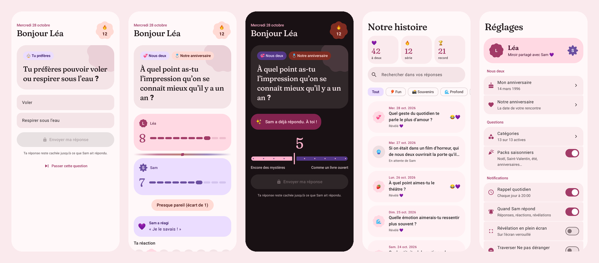

# Miroir

Une question par jour pour deux. Chacun répond de son côté ; les réponses ne se révèlent, en miroir, que lorsque les deux ont répondu.

Application Android native (Kotlin, Jetpack Compose, Material 3 Expressive). La synchronisation passe par un Worker Cloudflare (D1) et Firebase Cloud Messaging ; tout le contenu est chiffré de bout en bout.



## Fonctionnalités

- **Question du jour identique sur les deux téléphones** : tirage déterministe (pairId + date + joker), puis verrouillage de la première proposition par le Worker.
- **2 289 questions** en français (`questions/src`) : fun, souvenirs, profond, futur, nous deux, tu préfères, qui de nous deux, hypothétique, valeurs, goûts, enfance, voyages, petites choses du quotidien. Quatre formats : texte libre, choix multiple, échelle de 1 à 10, « qui de nous deux ».
- **Packs saisonniers** proposés automatiquement : Noël (20-26 déc.), nouvel an (30 déc.-2 janv.), Saint-Valentin (12-14 fév.), été (1 jour sur 3 environ, du 21 juin au 22 sept.), anniversaire de couple et anniversaires de chacun.
- Aucune répétition tant que la banque n'est pas épuisée, catégories activables, questions perso partagées et intégrées au tirage, joker « passer » une fois par jour.
- Révélation animée « effet miroir », réactions emoji et commentaire, série de jours 🔥, historique avec recherche et filtres.
- Rappel quotidien à heure fixe (alarme exacte), notification quand l'autre répond, révélation en plein écran optionnelle.
- Widget Glance aux couleurs dynamiques : question du jour et état (« À toi ! », « En attente de sa réponse », « Révélé 💜 »).
- Hors ligne : les réponses partent dès le retour du réseau (WorkManager).
- Mises à jour in-app depuis les GitHub Releases (vérification au lancement et toutes les 6 h).

## Confidentialité

- L'appairage se fait par QR code, d'un téléphone à l'autre. Le QR contient l'identifiant de la paire, le secret d'authentification et la **clé AES-256 du couple**. Cette clé n'est jamais envoyée au serveur.
- Réponses, réactions, profils, réglages partagés et questions perso sont chiffrés en AES-256-GCM avant envoi. Chaque chiffré est lié à son emplacement (données associées : paire, jour, membre) : le serveur ne peut ni lire ni permuter les réponses.
- La question du jour est désignée par une étiquette HMAC opaque : le serveur sait que vous avez répondu, pas à quoi.
- Le Worker ne transmet la réponse de l'autre qu'une fois les deux réponses reçues.
- Sur le téléphone, les secrets sont scellés par une clé de l'Android Keystore, et exclus des sauvegardes.

## Structure

| Dossier | Contenu |
| --- | --- |
| `app/` | Application Android (`com.karelisio.miroir`) |
| `worker/` | Worker Cloudflare en TypeScript + migrations D1 |
| `questions/` | Banque de questions (JSONL par catégorie), validateur et script d'assemblage |
| `.github/workflows/` | CI, release signée, déploiement du Worker |

API du Worker (authentification : `Authorization: Bearer <secret de paire>`, `X-Pair-Id`, `X-Member`) :

| Endpoint | Rôle |
| --- | --- |
| `POST /pair` | Création (`create`, membre A) ou rejointe (`join`, membre B) |
| `DELETE /pair` | Dissociation : efface toutes les données de la paire |
| `POST /state` | Synchronisation incrémentale (révision) et verrouillage de la question du jour |
| `POST /answer` | Réponse chiffrée ; notifie l'autre (« a répondu » ou « révélé ») |
| `POST /skip` | Joker du jour (une fois, avant toute réponse) |
| `POST /react` | Réaction et commentaire chiffrés (après révélation) |
| `POST /custom-question` | Ajout ou suppression d'une question perso chiffrée |
| `POST /settings` | Réglages partagés chiffrés (catégories, packs, anniversaire, fuseau) |
| `POST /profile` | Profil chiffré (prénom, anniversaire) |
| `POST /token/update` | Jeton FCM du téléphone |

## Mise en place

### 1. Projet Firebase (notifications push)

1. Sur [console.firebase.google.com](https://console.firebase.google.com), créez un projet (Google Analytics n'est pas nécessaire).
2. Ajoutez une application Android avec le nom de package `com.karelisio.miroir`, puis téléchargez `google-services.json`.
3. Vérifiez que l'API **Firebase Cloud Messaging (V1)** est activée : Paramètres du projet → Cloud Messaging.
4. Compte de service : Paramètres du projet → Comptes de service → **Générer une nouvelle clé privée**. Gardez ce fichier JSON à l'abri : c'est lui qui permet au Worker d'envoyer les notifications.

Sans Firebase, l'appli fonctionne quand même : elle se synchronise à l'ouverture, au rappel quotidien et toutes les heures.

### 2. Worker Cloudflare

**Option automatique (recommandée)** : le workflow « Déploiement du Worker » crée la base D1, applique les migrations, déploie et vérifie `/health`.

1. Sur [dash.cloudflare.com/profile/api-tokens](https://dash.cloudflare.com/profile/api-tokens) : « Créer un jeton » → modèle **Modifier Cloudflare Workers** (Edit Cloudflare Workers), ajoutez la permission **Compte → D1 → Modifier**, puis créez le jeton.
2. Ajoutez-le dans les secrets GitHub sous le nom `CLOUDFLARE_API_TOKEN` (et `FCM_SERVICE_ACCOUNT` avec le JSON du compte de service Firebase).
3. Lancez le workflow (Actions → Déploiement du Worker → Run workflow) ou poussez une modification de `worker/`. L'URL du Worker s'affiche dans le résumé de l'exécution.

**Option manuelle**, avec Node.js 20 ou plus :

```bash
cd worker
npm install
npx wrangler login
npx wrangler d1 create miroir          # copiez le database_id dans wrangler.toml
npx wrangler d1 migrations apply miroir --remote
npx wrangler secret put FCM_SERVICE_ACCOUNT < /chemin/vers/compte-de-service.json
npx wrangler deploy                    # affiche l'URL, ex. https://miroir.<vous>.workers.dev
```

Test rapide : `curl https://miroir.<vous>.workers.dev/health` doit répondre `{"ok":true,...}`.

En local : `npm run db:migrate:local` puis `npm run dev`.

### 3. Keystore de signature

Les mises à jour in-app ne s'installent que si chaque version est signée avec **la même clé**. Créez-la une seule fois et sauvegardez-la :

```bash
keytool -genkeypair -v -keystore miroir.jks -alias miroir -keyalg RSA -keysize 4096 -validity 36500
base64 -w0 miroir.jks > miroir.jks.b64
base64 -w0 google-services.json > google-services.json.b64
```

### 4. Secrets GitHub

Dans Settings → Secrets and variables → Actions du dépôt :

| Secret | Valeur |
| --- | --- |
| `KEYSTORE_B64` | Contenu de `miroir.jks.b64` |
| `KEYSTORE_PASSWORD` | Mot de passe du keystore |
| `KEY_ALIAS` | Alias de la clé (`miroir`) |
| `KEY_PASSWORD` | Mot de passe de la clé |
| `GOOGLE_SERVICES_JSON_B64` | Contenu de `google-services.json.b64` |
| `WORKER_URL` | Facultatif : remplace l'URL du Worker définie dans `gradle.properties` (`miroir.workerUrl`) |

Pour le déploiement automatique du Worker : `CLOUDFLARE_API_TOKEN` (modèle « Edit Cloudflare Workers » + D1 : Edit), `FCM_SERVICE_ACCOUNT` (le JSON du compte de service, tel quel) et, seulement si le jeton donne accès à plusieurs comptes, `CLOUDFLARE_ACCOUNT_ID`.

Aucun de ces fichiers n'est commité : `google-services.json`, `*.jks` et `keystore.properties` sont ignorés par git.

### 5. Publier une version

```bash
# Ajoutez une section « ## [1.0.0] » dans CHANGELOG.md, puis :
git tag v1.0.0
git push origin v1.0.0
```

Ou sans terminal : Actions → **Release** → *Run workflow* → version `1.0.0` (le tag est créé automatiquement).

Le workflow **Release** lance les tests, construit l'APK signé (`versionName` = tag, `versionCode` = numéro d'exécution), vérifie qu'il n'est pas signé en debug et publie une GitHub Release avec l'APK et le changelog. L'APK est aussi disponible en artefact.

La vérification des mises à jour interroge `https://api.github.com/repos/karelisio/miroir/releases/latest` sans authentification : le dépôt (ou au moins ses releases) doit être public.

### 6. Installer et relier les téléphones

1. Installez l'APK sur les deux téléphones et suivez l'introduction (autorisations une par une, toutes passables).
2. Sur le premier : « Créer notre miroir » affiche un QR code.
3. Sur le second : « Scanner le QR de l'autre ». C'est tout.

## Développement

```bash
node questions/build.mjs                 # régénère app/src/main/assets/questions.json
node questions/validate.mjs questions/src/fun.jsonl
./gradlew :app:assembleDebug             # sans google-services.json : FCM désactivé
./gradlew :app:testDebugUnitTest         # tirage, crypto, captures d'écran
```

Pour un build local signé, créez `keystore.properties` à la racine (ignoré par git) avec `KEYSTORE_FILE`, `KEYSTORE_PASSWORD`, `KEY_ALIAS`, `KEY_PASSWORD` et éventuellement `WORKER_URL`.

Les captures Roborazzi (thème de repli rose/violet) sont écrites dans `app/build/outputs/roborazzi/screenshots/`. Derrière un proxy qui limite Maven Central, ajoutez `-ProbolectricRepo=<miroir Maven>` pour les jars Android de Robolectric.

Pile technique : AGP 9.4, Kotlin 2.3, Compose BOM 2026.09 + Material 3 1.5 (Expressive), Navigation Compose, Room, DataStore, WorkManager, Glance, CameraX + ML Kit (modèle embarqué), ZXing, OkHttp, kotlinx.serialization. Police des titres : [Fraunces](https://github.com/undercasetype/Fraunces) (SIL OFL, voir `licenses/`).
